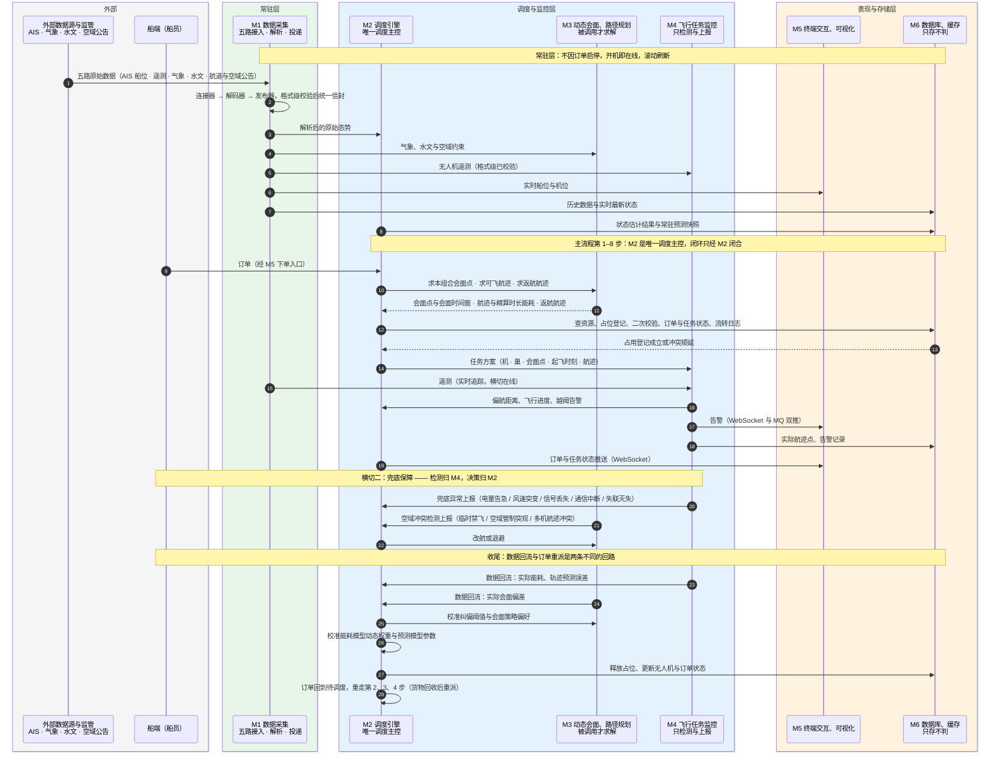

# 91-1 全局鸟瞰

> 口径说明：本文是图，属于辅助视图；**与正文表述冲突时一律以正文为准**。
> 图集索引见 [91-时序图](91-时序图.md)。
> 对应正文：[22-接口契约](../../20-总体设计/22-接口契约.md) §5、[21-主流程设计](../../20-总体设计/21-主流程设计.md) §2。

## 1 六个模块与外部：每条契约一条消息

## 2 说明

1. 本图是 `22` §5「模块间调用契约」的可视化，**每个环节只画一条代表性消息**，判据与字段细节见 `91-3`–`91-9` 各图。
2. 数据回流的发起方按 `22` §5 画：`M4、M3 → M2`，机载飞控不是回流发起方（`22` §6 原写 `FC → DP`，已修正）。分项归口见 `91-7` §3 说明。
3. `M5 → M2` 的下单与人工干预链路、`M4 → M5` 的推送链路见 `91-8`；M6 的读写分工见 `91-9`。
