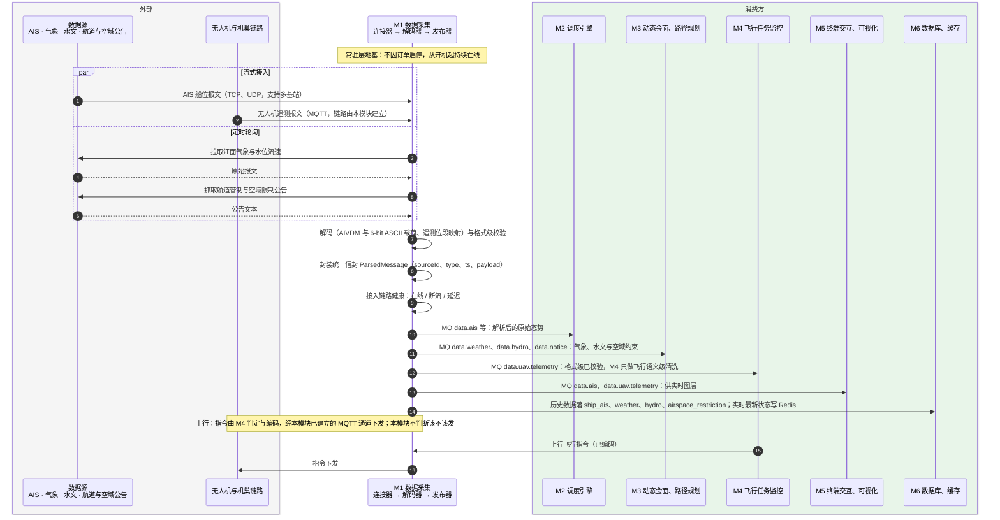

# 91-2 接入链路

> 口径说明：本文是图，属于辅助视图；**与正文表述冲突时一律以正文为准**。
> 图集索引见 [91-时序图](91-时序图.md)。
> 对应正文：[30-M1-数据采集](../../30-模块详细设计/30-M1-数据采集.md) §1、§2、[22-接口契约](../../20-总体设计/22-接口契约.md) §1。

## 1 M1 五路接入、解析、投递，以及上行指令的下发通道

## 2 说明

1. **遥测只接入一次**：M4 不直连 MQTT，其校验职责上移为飞行语义级（野值剔除、丢包外推）。
2. M6 不作为 MQ 消费方：落库与入缓存由 `M1 → M6` 的调用完成（见 `91-9`）。
3. M1 不做状态估计（归 M2）、不做坐标与单位归一（归 M6）、不建业务表。
