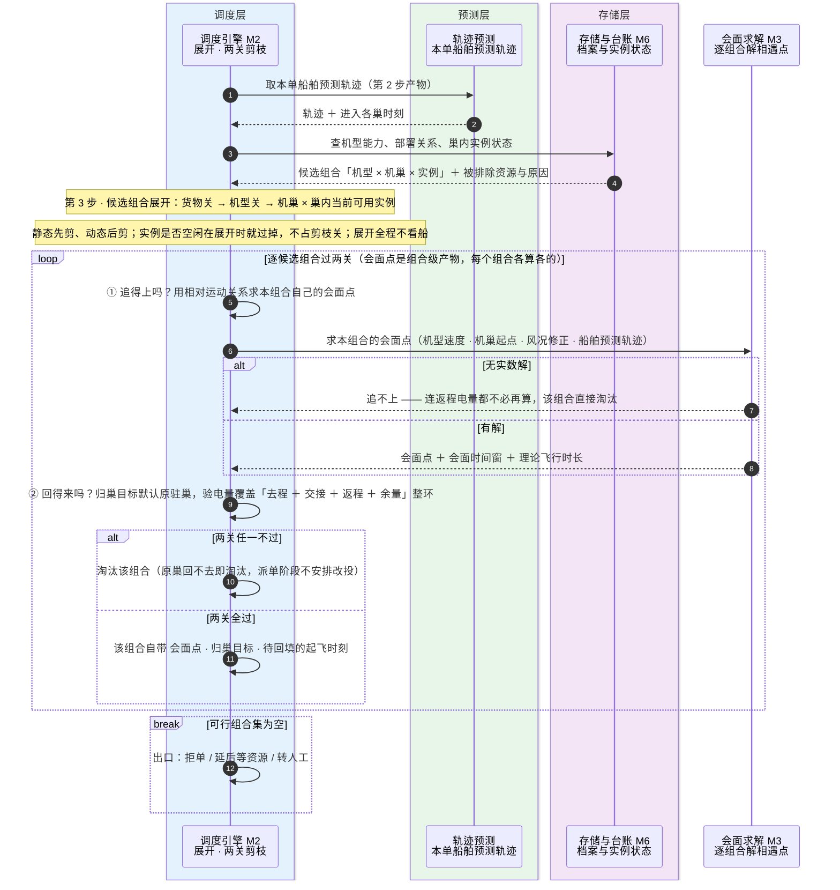

# 91-4 剪枝派单

> 口径说明：本文是图，属于辅助视图；**与正文表述冲突时一律以正文为准**。
> 图集索引见 [91-时序图](91-时序图.md)。
> 对应正文：[21-主流程设计](../../20-总体设计/21-主流程设计.md) §2 第 3 步、[24-选机链设计](../../20-总体设计/24-选机链设计.md) §3。

## 1 第 3 步：候选组合展开与两关剪枝

