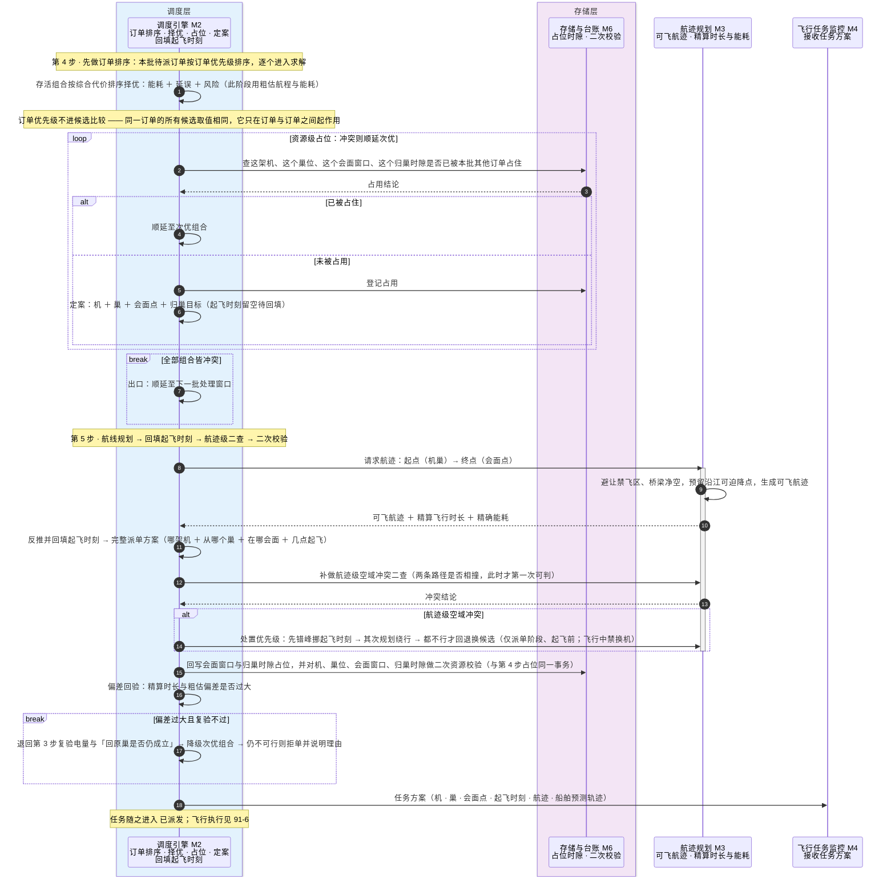

# 91-5 择优回填

> 口径说明：本文是图，属于辅助视图；**与正文表述冲突时一律以正文为准**。
> 图集索引见 [91-时序图](91-时序图.md)。
> 对应正文：[21-主流程设计](../../20-总体设计/21-主流程设计.md) §2 第 4、5 步、[24-选机链设计](../../20-总体设计/24-选机链设计.md) §5、[27-一致性约束](../../20-总体设计/27-一致性约束.md)。

## 1 第 4–5 步：订单排序、综合择优、资源级占位、航迹精算与起飞时刻回填

## 2 说明

1. 第 5 步的「任务下达 `M2 → M4`」是本图与 `91-6` 的接口，`91-6` 从 M4 收到任务方案起画。
2. 占位与二次校验必须同一事务，见 `27` §4；`91-9` 从 M6 视角再看一次这两步。
