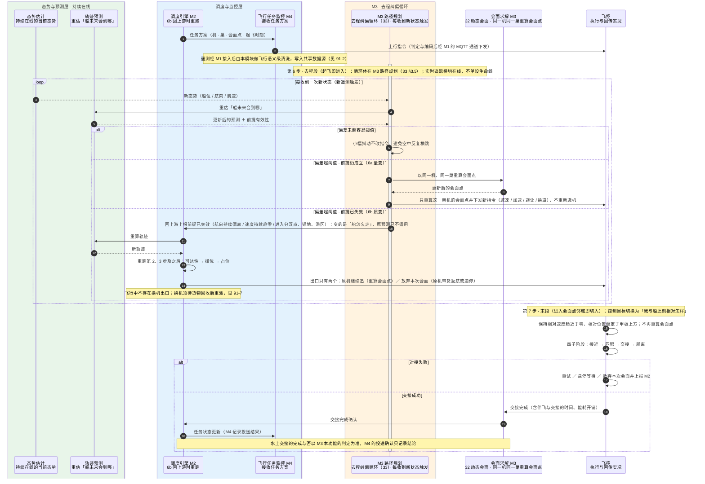
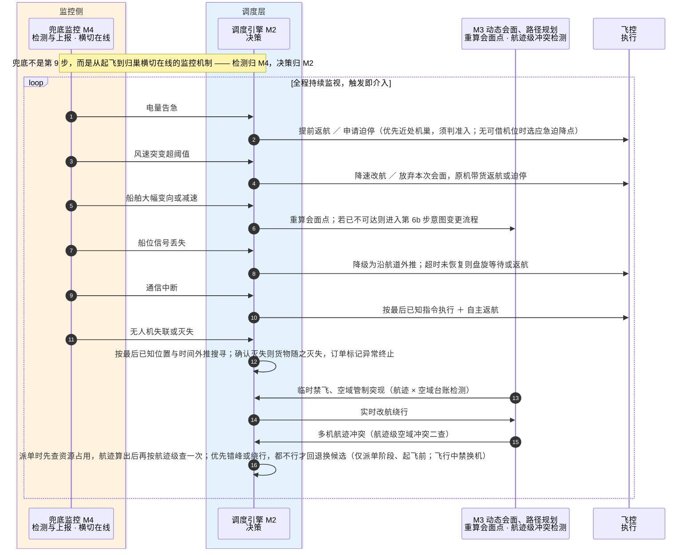

# 91-6 飞行执行

> 口径说明：本文是图，属于辅助视图；**与正文表述冲突时一律以正文为准**。
> 图集索引见 [91-时序图](91-时序图.md)。
> 对应正文：[21-主流程设计](../../20-总体设计/21-主流程设计.md) §2 第 6、7 步、§6、§7、[33-M3-路径规划](../../30-模块详细设计/33-M3-路径规划.md) §3.5。

## 1 第 6–7 步：去程追踪与纠偏、末段会面与交接

## 2 兜底保障：横切在线

## 3 说明

1. 任务下达按 `22` §5 画成 `M2 → M4`；飞控侧的上行指令由 M4 判定与编码、经 M1 的 MQTT 通道下发（M1 的收发链路见 `91-2`）。
2. 兜底一图中「`M2` 决策 → M3 执行改航或退避」按 `22` §5 与 `21` §7 画出 `M3` 这一环，不再让检测侧直接指挥飞控。
3. 6b 与末段交接确认的发起方都不是飞控：6b 由 M3 判定后上报 M2，交接完成由 M3 判定后回报 M2——依据 `22` §5 的硬约定「闭环只经 M2 闭合」与 `32` §3.5、`33` §3.5。
4. **去程纠偏循环体在 M3**：第 6 步去程段环形循环由 **M3 路径规划（33 §3.5）**承载、以「每收到一次新状态（新遥测）」为触发，**飞控（FC）不驱动该循环、不直连 TP／RS**，FC 只执行与回传实况——依据 `22` §7.2 **U-01 裁定**（2026-10-10，组长）。本图第 1 节已按此订正（循环驱动方由 FC 改为 M3）。
