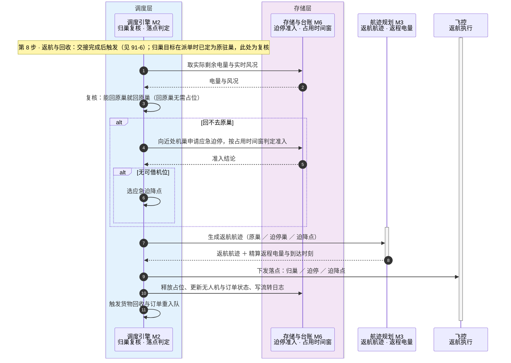
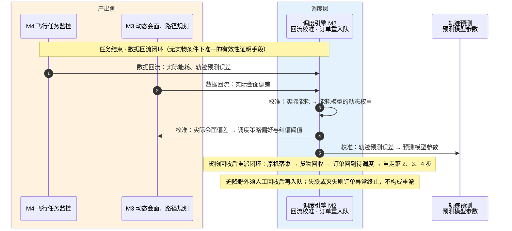

# 91-7 返航收尾

> 口径说明：本文是图，属于辅助视图；**与正文表述冲突时一律以正文为准**。
> 图集索引见 [91-时序图](91-时序图.md)。
> 对应正文：[21-主流程设计](../../20-总体设计/21-主流程设计.md) §2 第 8 步、§8、§9、[25-返航设计](../../20-总体设计/25-返航设计.md)。

## 1 第 8 步：返航复核与落点判定

## 2 收尾：数据回流闭环与货物回收后重派闭环

## 3 说明

1. 数据回流的发起方按 `22` §5 画：`M4、M3 → M2`，**机载飞控不是回流发起方**（`22` §6 原写 `FC → DP`，已按本条修正）。实际会面偏差的产出方见 `32-M3-动态会面` §3.6；实际能耗与轨迹预测误差的分项归口正文尚未写死，本图按排除法归 M4 侧——若 53 另有定论，以定论为准。
2. 第 1 节的交接完成确认同属此类：水上交接的完成与否以 M3 的判定为准，飞控只执行与回传实况（`32` §3.5），故图上是 `FC → M3 → M2` 两跳。
3. 第 8 步的复核由 M2 发起：实际剩余电量与实时风况取自 M6（`22` §5 第 8 步行），飞控只接收落点指令，不作为上报发起方。
4. 「货物回收后重派」与「数据回流」是两条不同的回路：前者回流订单本身，后者回流用于校准模型的数据（`21` §8、§9）。
