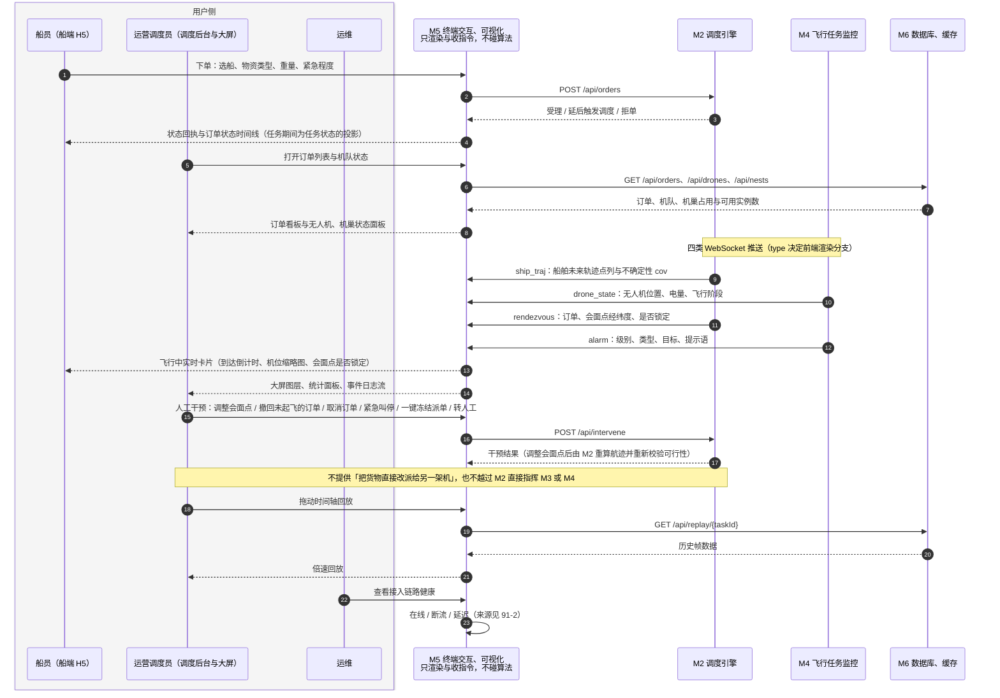

# 91-8 交互链路

> 口径说明：本文是图，属于辅助视图；**与正文表述冲突时一律以正文为准**。
> 图集索引见 [91-时序图](91-时序图.md)。
> 对应正文：[35-M5-终端交互](../../30-模块详细设计/35-M5-终端交互.md) §3、§4.4、[36-M5-可视化](../../30-模块详细设计/36-M5-可视化.md) §2、§3、[22-接口契约](../../20-总体设计/22-接口契约.md) §3、§4。

## 1 M5：下单、查询、推送、人工干预、回放

## 2 说明

1. 前端只做渲染与指令收集，全部数据经后端中转；字段口径以 `22` §3、§4 为准。
2. 干预动作的边界（允许什么、不允许什么）以 `35` §4.4 为准，本图只画链路。
3. 大屏的「算法输出到画面的映射」对照表在 `36` §3。
