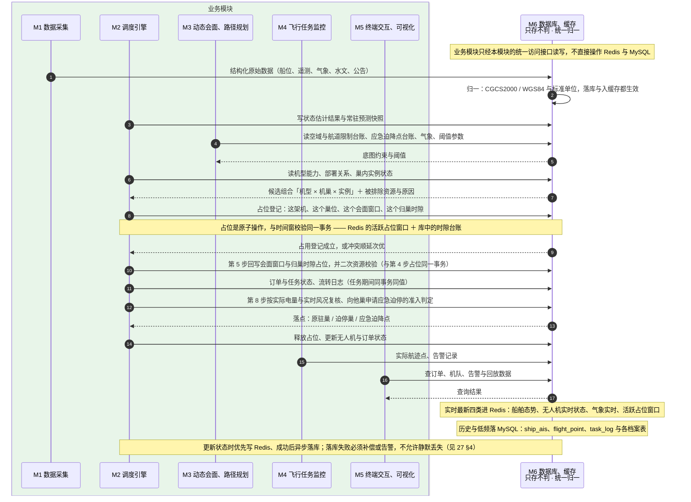

# 91-9 落库链路

> 口径说明：本文是图，属于辅助视图；**与正文表述冲突时一律以正文为准**。
> 图集索引见 [91-时序图](91-时序图.md)。
> 对应正文：[37-M6-数据库](../../30-模块详细设计/37-M6-数据库.md) §2、§3、§5、[38-M6-缓存](../../30-模块详细设计/38-M6-缓存.md) §2、§3、[27-一致性约束](../../20-总体设计/27-一致性约束.md)。

## 1 M6：各模块读写需求、占位事务与二次校验、归一、缓存与库的分工

## 2 说明

1. M6 **只负责存储与一致性，不判断流转**：货物状态的写入方划分见 `37` §2。
2. 表结构与字段的唯一权威处是 `37`；本图只画读写时序，不复制字段。
3. 缓存键命名、TTL 与降级策略仍是未决项（`53` §2），落地前须定死。
