# 92-1 订单状态机

> 口径说明：本文是图，属于辅助视图；**与正文表述冲突时一律以正文为准**。
> 图集索引见 [92-状态图](92-状态图.md)。
> 对应正文：[23-状态机定义](../../20-总体设计/23-状态机定义.md) §3、§5、§8。

## 1 12 态与正向唯一路径

```mermaid
stateDiagram-v2
    direction LR
    accTitle: 订单状态机
    accDescr: 订单一单一个状态，从待受理经已受理待唤醒或直接进入待调度，到调度中、已派发，再随任务投影走去程中、末段交接中、返航中至已完成，另有已拒绝、失败、异常终止三个互斥终止态。

    state "待受理 · 接单判定尚未完成" as Created
    state "已受理待唤醒 · 受理不派单" as Waiting
    state "待调度 · 已过派单前置门，入派单队列" as Queued
    state "调度中 · 第 2–5 步求解中" as Solving
    state "已派发 · 起飞时刻已回填，任务已下达" as Dispatched
    state "去程中 · 第 6 步" as Outbound
    state "末段交接中 · 第 7 步" as Handover
    state "返航中 · 第 8 步" as Returning
    state "已完成 · 交接成功" as Done
    state "已拒绝 · 业务边界不满足或无可行情组合" as Rejected
    state "失败 · 迫降野外，转人工回收" as Failed
    state "异常终止 · 货物灭失" as Terminated

    [*] --> Created : 订单创建

    %% ===== 受理与唤醒 =====
    Created --> Waiting : M2 受理判定 · 等船（尚未驶入系统服务航段）或等货（货物未备好）
    Created --> Queued : M2 受理判定 · 机场在服务航段内且货物已就绪，可跳过唤醒
    Waiting --> Queued : 前置门满足（驶入服务航段 / 货物备好）

    %% ===== 求解与派发 =====
    Queued --> Solving : 第 2 步起进入求解
    Solving --> Dispatched : 第 4 步占位定案，并经第 5 步回填复核通过
    Solving --> Rejected : 第 3 步无可行组合，或第 5 步降级次优后仍不可行

    %% ===== 任务期间的投影段 =====
    Dispatched --> Outbound : 起飞确认（任务状态投影）
    Outbound --> Handover : 进入会面点邻域（任务状态投影）
    Handover --> Returning : 交接完成（任务状态投影）
    Returning --> Done : 落巢确认（任务状态投影）

    %% ===== 终止态 =====
    Returning --> Failed : 迫降野外，转人工回收
    Outbound --> Terminated : 无人机灭失判定成立，货物随之灭失
    Handover --> Terminated : 无人机灭失判定成立，货物随之灭失
    Returning --> Terminated : 无人机灭失判定成立，货物随之灭失
    Rejected --> [*]
    Failed --> [*]
    Terminated --> [*]

    note right of Solving
        第 5 步精算回填后复核不通过，先降级到次优组合；
        仍不可行才回到已拒绝并说明理由。
    end note

    note left of Returning
        归巢余量不足、迫停他巢的情形不改变订单状态，
        只改变任务的落点——订单侧不展开任务侧独有的异常态。
    end note
```

## 2 说明

1. `已派发` 起为**任务状态的投影**：任务存在期间两侧取值保持一致，任何变更在同一事务内回写（`23` §5）。
2. 三个终止态 `已拒绝`、`失败`、`异常终止` 互斥，进入后不再流转（`23` §3 约束 3）。
3. 订单侧独有、不写任务表的状态是 `待受理`、`已受理待唤醒`、`待调度`、`调度中`、`已拒绝`（`23` §5）。
