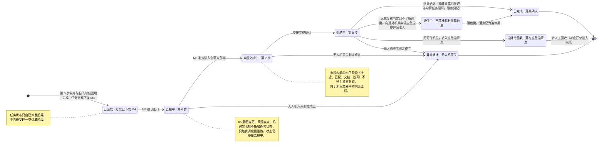

# 92-2 任务状态机

> 口径说明：本文是图，属于辅助视图；**与正文表述冲突时一律以正文为准**。
> 图集索引见 [92-状态图](92-状态图.md)。
> 对应正文：[23-状态机定义](../../20-总体设计/23-状态机定义.md) §4、§5、§8。

## 1 一次飞行一个状态：5 个正常态 ＋ 3 个异常态

## 2 说明

1. `已派发` 到 `返航中` 四态与订单状态**同名同值**，任务侧变更在同一事务内回写订单（`23` §5）。
2. `迫停中`、`迫降待回收` 是任务侧独有，不在订单侧展开，由落点字段与订单终止态表达。
3. 状态写入方：除 `迫停中`／`迫降待回收`（M4 上报、M2 决策）与失联灭失类（M4 判定上报）外，任务状态推进均由 M4 在事实发生时写入（`23` §8）。
