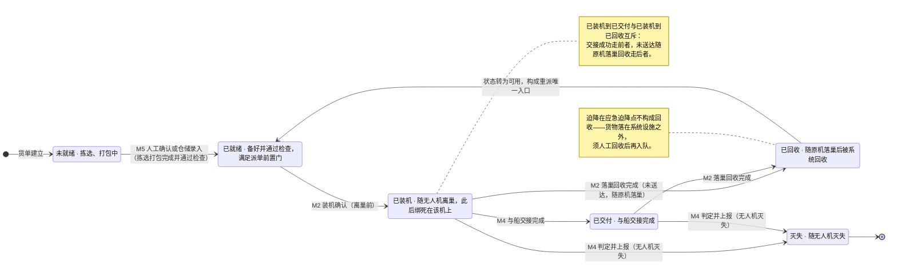

# 92-3 货物状态机

> 口径说明：本文是图，属于辅助视图；**与正文表述冲突时一律以正文为准**。
> 图集索引见 [92-状态图](92-状态图.md)。
> 对应正文：[23-状态机定义](../../20-总体设计/23-状态机定义.md) §6、§8。

## 1 一票货一个状态：6 态，两个互斥出口

## 2 说明

1. 货物是**有限对象**：离巢后绑死在该机上，空中不可转移，因此只有落进机巢才谈得上回收与重派（`21` §8）。
2. 当前载体与当前位置必须持续跟踪，位置不是「记一笔」，而是重派剪枝的必要输入（`23` §6 约束 3）。
3. `灭失` 与订单 `异常终止` 联动（`23` §8）。
