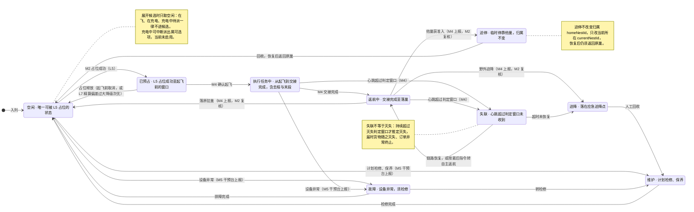

# 92-4 无人机状态机

> 口径说明：本文是图，属于辅助视图；**与正文表述冲突时一律以正文为准**。
> 图集索引见 [92-状态图](92-状态图.md)。
> 对应正文：[23-状态机定义](../../20-总体设计/23-状态机定义.md) §7、§8、§11。

## 1 一架机一个状态：9 态

## 2 说明

1. `执行任务中` 覆盖去程与末段两段；末段四子阶段不另建状态（`23` §4、§7）。
2. **任一状态**检出设备异常或计划检修，均由人工经 M5 干预台转入 `故障` 或 `维护`（`23` §7、§8）；图中只画了代表性入口，不逐态连线。
3. 状态名以本文所示为准，旧写法（`空闲待命`、`已占位待起飞`、`链路中断` 等）已在 `23` §9 列为禁用。
